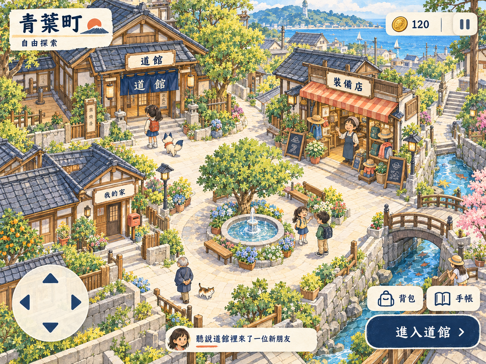
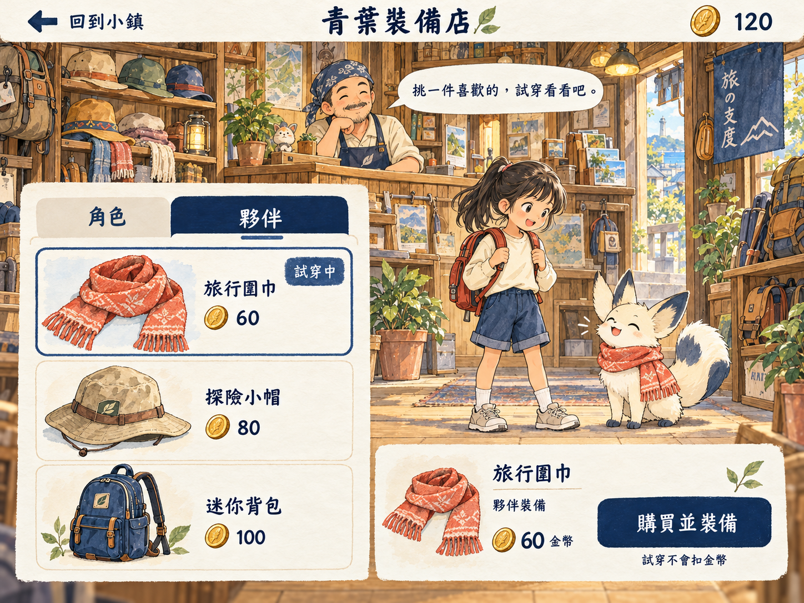
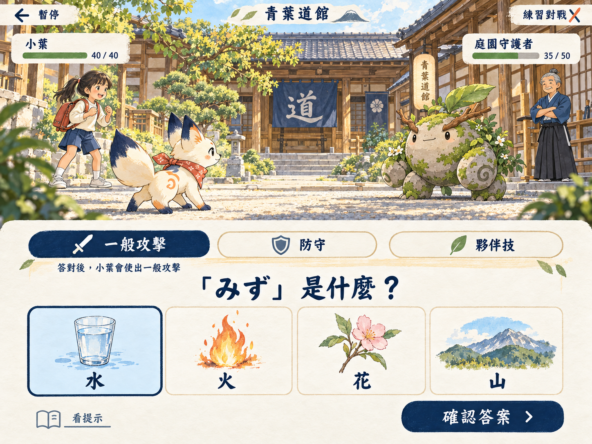

# 已確認的美術方向與冒險概念

2026-10-16，使用者選擇第二張「日語旅行手帳」美術與平板優先；看過下列三張冒險概念後同意依此推進。來源為本session的image_gen生成；沒有取得或複製參考遊戲的角色／地圖素材。

這是美術與互動意圖的方向確認，**不是可操作原型、教材審核、數值定案或實機驗收**。第一張舊「今天」版型只保留其美術參考價值；正式首頁改冒險續玩。道館圖的數字與商店價格不優先於[設計契約](../ADVENTURE_RPG_SPEC.md)。

| 圖稿 | 用途 | 正式實作差異 |
|---|---|---|
| [第二張風格](style-travel-journal.png) | 墨線、水彩、紙感、角色／建築細節 | 不沿用每日作業清單首頁 |
| [小鎮](town-exploration.png) | 地圖空間、入口、跟隨夥伴與互動 | 拆地形／碰撞／角色／DOM；點地面為主，可切方向控制 |
| [商店](equipment-shop.png) | 角色／夥伴分類、試穿、購買並裝備 | 商品、價格、效果依catalog；測錯誤、已擁有與小螢幕 |
| [戰鬥](dojo-battle.png) | 角色對戰與下方清楚作答區 | 真文字、四題型、長題收合；選招後鎖定題目，需先保存再播結果 |

原圖保持原始位元組；[manifest.json](manifest.json)記錄檔名、hash、容量與生成來源。僅作docs審閱參考，不加入正式離線包。P2-11還要產出角色設定表、可動畫／換裝的分層資產與權利檢查，並經真人視覺核對。圖稿中的角色與夥伴造型尚未綁定正式既有ID。

